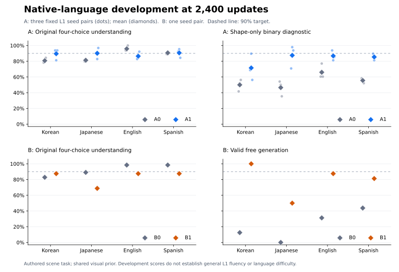
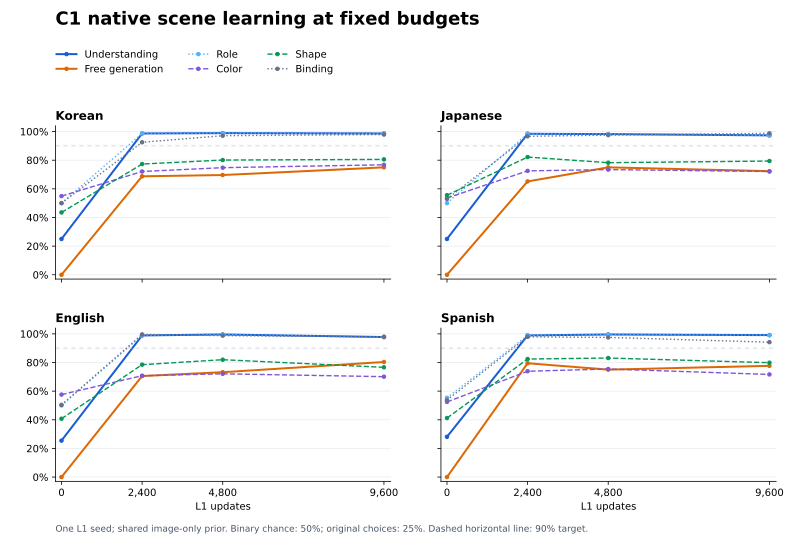

# L1 개발 결과: 2026-11-14

원본 실행은 [43630516311](https://github.com/doheyn1008/DoVIS/actions/runs/43630516311), 동결 소스는 `5632c752d081ab39f2d47afc59877aaac3bc7d32`입니다. A/B 전체가 성공적으로 완료됐습니다. 원본 machine-readable 집계와 독립 검증 기록은 `results/l1-mastery/2026-11-14-AB/`에 보존합니다. 실제 checkpoint·Adam·난수·개별 예측·원본 생성은 실행의 artifact에30일 보존됩니다.

이 결과는 네 가지 직접 작성한 문형과 제한된 그림 세계의 개발 결과입니다. 자연언어 전반의 모국어 능력이나 언어 간 습득 난이도 결과가 아닙니다. 언어 사이의 CPU host가 달라 실행 초를 언어별 학습 속도로 비교하면 안 됩니다.

그림은 원본 집계에서 `python scripts/plot_mastery_ab.py`로 재생성할 수 있습니다. 그림 생성에만 선택 의존성 `matplotlib`이 필요합니다.

## A: 속성 오답

사전에 고정한 세 초기화/훈련 seed 쌍을 네 언어 모두 실행했습니다. 아래는 최종2,400-step의 세 seed 평균입니다.

| 언어 | 기존4지선다 A0 | 기존4지선다 A1 | 도형 진단 A0 | 도형 진단 A1 |
|---|---:|---:|---:|---:|
| 한국어 | 80.73% | 89.58% | 50.00% | 71.53% |
| 일본어 | 81.25% | 90.10% | 46.53% | 87.50% |
| 영어 | 95.83% | 86.46% | 65.97% | 86.81% |
| 스페인어 | 90.63% | 90.63% | 55.56% | 85.42% |

네 속성 진단의 동등 가중 macro 차이는 전체+9.0929%p, 세 seed 블록은 각각+12.8255/+7.1615/+7.2917%p였습니다. 그러나 영어의 기존 이해 차이−9.375%p가 사전 허용치−5%p를 넘어서 **B 정책은 `same_pair`**로 정해졌습니다. 속성 개선을 이유로 이 규칙을 사후 변경하지 않았습니다.

24개 trial·72개 관측이 완료됐습니다. checkpoint72개의 SHA256, 12개 paired trial의 초기 가중치·의미/이해 문장 스트림·같은 runner 환경·최종 생성기 해시를 독립 검증했습니다. 모든 A0/A1 생성 점수 차이는0이었습니다. 각 seed에서 네 언어의 초기 이해/생성/시각 가중치와 의미 표본 스트림도 같았습니다. 세 seed 블록을 기본 반복 단위로 보며12개 언어×seed 셀을 독립 반복12개로 취급하지 않습니다.

## B: 고정 공간 CNN의 이미지 재구성 사전학습

사전 고정한 개발 seed 한 쌍에서 네 언어를 실행했습니다. 아래는 최종2,400-step입니다. 생성은16장면, 기존 이해는64문장, 도형 진단은48문장입니다.

| 언어 | 기존 이해 B0→B1 | 유효 자유 생성 B0→B1 | 도형 진단 B0→B1 |
|---|---:|---:|---:|
| 한국어 | 53→56 /64 | 2→16 /16 | 28→36 /48 |
| 일본어 | 57→44 /64 | 0→8 /16 | 31→37 /48 |
| 영어 | 63→56 /64 | 5→14 /16 | 20→31 /48 |
| 스페인어 | 63→56 /64 | 7→13 /16 | 25→38 /48 |

이미지 재구성 prior는 네 언어 모두에서 생성과 도형 진단을 개선했지만 기존 이해는 세 언어에서 낮아졌습니다. 따라서 B1을 전체 L1 능력의 승자로 선언하지 않습니다. 중간 checkpoint의 최고 점수도 최종 예산 점수를 대신하지 않습니다. 네 언어가 같은 시각 prior를 공유하므로 네 번의 독립된 prior 반복이 아닙니다.

## 남은 한계와 C 활성화

A의72개 관측 모두 실제 점수 목표를 통과하지 못했습니다. A/B는 기존 dev의 결합 진단이4anchor/1쌍이어서 최소8anchor/2쌍 규칙에도 못 미칩니다. **점수 미달과 평가 표본 부족이 함께 존재**합니다. 한국어 B1의 생성16/16만으로 L1 후보라고 부를 수 없습니다.

이를 근거로 별도 자료 버전 C를 활성화합니다. 기존10fit/4dev 경계와22보호쌍 제외를 유지하고, 새5색 세계에서55fit/28dev쌍 및 결합60anchor/15쌍을 확보합니다. 모델·선택 정책·후보 규칙을 유지한 C0/C1 대조이며 새 자료와 기존 자료의 점수를 같은 시험에서의 개선처럼 비교하지 않습니다. 자료·seed·2,400/4,800/9,600-step 예산·계획 SHA256을 실행 전에 고정합니다.

생성 attention은 준비된 후속 가설입니다. C 오류를 확인한 뒤 같은 C 자료·prior·정책·예산에서 생성기만 바꾸는 별도 실험으로 평가할 수 있습니다. 후보가 생기면 설계를 동결한 후 새 독립 L1 seed에서 검증해야 합니다. 연구용 checkpoint나 외국어 학습으로 자동 승격하지 않습니다.

## C: 충분한 조합을 가진 별도 개발 세계

실행 [43632332293](https://github.com/doheyn1008/DoVIS/actions/runs/43632332293), 동결 소스 `8288fb0d345c178d4b5e04139b86eacea0935d7b`의 네 언어8개 trial이 모두 사전 고정한9,600step을 완료했습니다. 아래는 최종 예산 결과이며 기존 A/B와 다른 모집단입니다.

| 언어 | 기존 이해 C0→C1 /448 | 유효 자유 생성 C0→C1 /112 | C1 색 /448 | C1 도형 /432 |
|---|---:|---:|---:|---:|
| 한국어 | 444→442 | 70→84 | 344 | 348 |
| 일본어 | 448→436 | 46→81 | 323 | 343 |
| 영어 | 448→438 | 91→90 | 314 | 331 |
| 스페인어 | 448→444 | 66→87 | 321 | 345 |

각 진단의 평가 범위는 이제 역할112anchor/28쌍·색112/28·도형108/27·결합60/15로 충분합니다. 그럼에도 **최종8개 모델 모두 실제 점수 목표 미달**입니다. C1의 새 조합 생성은75.0/72.3/80.4/77.7%이고 색·도형 진단도90% 이하입니다. 기존4지선다 이해만으로 속성 이해를 평가하면 이 결함을 놓칩니다.

곡선은 다음 비교에서 고정할 C1 prior의 결과이며 C0도 원본 집계와 위 표에 모두 남겼습니다. C1을 전반적 이해의 승자로 선언하지 않습니다. 일부 점수는4,800step 이후 내려가므로 최종 예산을 중간 최고점으로 대신하지 않습니다. 그림은 `python scripts/plot_mastery_c.py`로 원본 집계에서 재생성합니다.

영어 C1은 fit220장면 생성217/220인 반면 dev는90/112입니다. 스페인어 C1도 fit212/220, dev87/112입니다. 남은 오류는 주로 새로운 대상 조합의 색·속성 혼동입니다. 실제 영어 체크포인트를 복원해 사전 고정된 첫3개 dev그림을 시험하면 두 개는 맞지만, 가운데 그림의 파란 원을 초록 원으로 설명합니다. 종료·읽기 전용 상태 검사는 모두 통과합니다. 이 관측은 생성 중 공간 정보를 다시 참조하는 후속 가설의 근거이지 그 방법의 효과를 미리 증명한 것은 아닙니다.

독립 감사는32개 체크포인트의 파일 SHA256과 실제 초기/최종 U/P·전 관측 시각 텐서, 네 언어 초기값과 의미 스트림, 원본 생성/예측에서 다시 계산한 모든 목표, fit55/dev28 및 기존22보호쌍 제외를 확인했습니다. 공식32개 관측 집계와도 일치합니다. 감사와 원본 요약은 `results/l1-mastery/2026-11-14-C/`에 보존했습니다.

## D/E의 사전 고정된 두 대조

위 C 결과를 근거로 소스 `9cf239215883258ea538fdc7579d67ae8442b610`에서 [D 생성기 비교](https://github.com/doheyn1008/DoVIS/actions/runs/43634533038)와 [E 오답 정책 비교](https://github.com/doheyn1008/DoVIS/actions/runs/43634532997)를 병렬 시작했습니다. D/E 결과를 보기 전에 [근거와 해석 규칙](https://github.com/doheyn1008/DoVIS/pull/5#issuecomment-6883307005)을 기록했습니다.

D는 기본 생성기 대 attention 생성기이고, E는 attention 생성기로 **미리 고정한 상태**에서 기존 오답 대 혼합 오답입니다. E가 D의 관측 승자를 선택하는 구조가 아닙니다. 각 대조는 같은 자료·B1prior·seed·예산이며 D는 최종 이해기 동일성, E는 최종 생성기 동일성을 검사합니다. E0가 D1 설정을 반복하는 것은 독립 반복이 아니며 서로 다른 CPU host의 최종 텐서 동일성도 가정하지 않습니다.

후보 판정은 실제 최종 E1 체크포인트 하나에서 모든 능력이 함께 기준을 통과해야 합니다. 실험 간 좋은 점수만 합쳐 후보를 만들지 않습니다. 후속 독립 L1 seed `(69007,69009)`, `(69017,69019)`, `(69027,69029)`도 D/E 결과를 보기 전에 `mastery-validation-plan.json`에 고정했습니다. 이 검증은 네 언어의 E1이 먼저 모두 통과할 때만 활성화하며 새 seed12개 모델의 최종 기준을 모두 확인합니다. 같은 시각 prior에 조건부인 L1 반복이고 시각 prior의 독립 반복은 아닙니다.

## 실행 신뢰성과 추론 도구

소스 `9cf2392`는 취소 처리 중 저장까지 실패해도 원래 인터럽트를 전달하도록 세 실행기를 수정합니다. 메모리 취소 기록을 먼저 보존하며 checkpoint·report·suite 저장 실패나 추가 인터럽트 때문에 다음 모델을 시작하지 않습니다. 이 수정과 D/E·추론 도구를 포함한 전체188개 실제 PyTorch 검사가 통과했습니다. 공식 C 실행에는 취소/저장 실패가 없었습니다.

`mastery_infer`로 공식 B0/B1 및 C1 실제 가중치를 복원하고 PNG 설명 추론의 가중치·난수 불변성을 확인했습니다. 원본 코드·sidecar·prior를 함께 사용해야 하며, 사용 예는 `l1-mastery.md`에 있습니다.

후속 리뷰가 발견한 executable-module의 factory 이름 문제도 수정했습니다. D/E factory는 앞으로 정규 모듈 이름을 기록하고, 이미 실행한 `9cf2392` 가중치는 알려진 네 `__main__` 별칭을 C단계·정확한 모델 구조·원본 핵심 소스 검증 아래에서 읽습니다. 공식 일본어 D0/D1 최종 가중치를 실제로 복원해 생성과 읽기 전용 상태 검사를 통과했습니다. 학습 계산을 바꾸는 수정은 아닙니다. `unicode-bmp`가 잘못된 surrogate를 생성해도 진단 JSON이 출력되도록 ASCII escape를 사용하고 실제 strict UTF-8 subprocess 회귀 검사도 추가했습니다. 이 수정과 조건부 새 seed 검증 도구를 포함한 전체202개 실제 PyTorch 검사가 통과했습니다.
